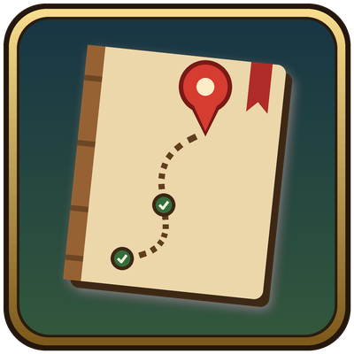

# Roadbook



**Ten quests ready to turn in, scattered over three zones? Roadbook puts them in the fastest order and points the way.**

Roadbook builds a turn-in round from your quest log, sorts it by travel time and drives the TomTom arrow from stop to stop. It knows which flight points you have discovered, sends you to the flight master when flying is faster, and tells you where to fly. It also comes with a notebook and a macro library.

## Features

- **Turn-in round in one click:** takes every quest in your log that is ready to turn in, looks up the turn-in NPC in QuestieDB and builds a route from where you stand.
- **Ordered by travel time, not by distance:** walking, flights between the flight points you know, zeppelins and boats between continents, and one zone at a time where possible.
- **Flight master first:** when a flight saves time, the arrow first points to the flight master and the chat tells you where to fly. After landing it points to your destination.
- **Undiscovered flight master nearby?** Roadbook tells you once, so you can pick it up on the way. `/rb fm` sets a waypoint.
- **Step tracker** below the minimap: next step, distance, travel hint, and quests ready to turn in that are missing from your plan.
- **Your own plans:** save your TomTom waypoints as a plan, remember your current position with `/rb here`, reorder, rename and sort steps. Everything you delete stays in the trash for 10 minutes.
- **Two modes:** *Route* (one step after the other) and *All points* (all open steps on the map, arrow to the one you reach fastest).
- **Share plans as text:** *Export* shows a plan as plain text, *Import plan* reads it. The import also understands `/way` lines.
- **Notebook:** notes per character or for all your characters, and one note per plan.
- **Macro library:** suggested macros can be created, updated, undone and picked up onto the cursor. Suggestions come from a content pack (see below).
- **English and German** client support.
- **Lightweight and private:** no bundled libraries, nothing is sent to other players or anywhere else. Your data stays in your own SavedVariables.

## Requirements

| Addon | Needed for |
|---|---|
| [TomTom](https://www.curseforge.com/wow/addons/tomtom) (required) | waypoints and the arrow |
| [QuestieDB](https://www.curseforge.com/wow/addons/questiedb) (required) | finding the turn-in NPC of a quest |

Both are separate addons and are **not** included. Roadbook only calls them while the game runs.

Game version: WoW Forever (Interface 16001).

## Installation

Install Roadbook with the CurseForge app, or download a release, unpack it and put the `Roadbook` folder into `Interface\AddOns`. Install TomTom and QuestieDB the same way.

## Commands

- `/rb` or `/roadbook` – open or close the window
- `/rb turnin` – build and load a turn-in round
- `/rb plan <name>` – load a plan · `/rb off` – unload it
- `/rb skip` – skip the current step · `/rb reset` – reset the plan
- `/rb waypoints` – set the TomTom waypoints and the arrow again
- `/rb sort` – order the open steps by travel time · `/rb route` – route description with flights and times
- `/rb here [name]` – remember your current position as a step
- `/rb tomtom <name>` – save your current TomTom waypoints as a plan
- `/rb import` · `/rb export` – share plans as text
- `/rb fm` – waypoint to an undiscovered flight master nearby
- `/rb note <title>` · `/rb trash` · `/rb tracker` · `/rb minimap`
- `/rb log` · `/rb debug` · `/rb layout` – for bug reports

There is also a minimap button, an entry in the addon menu at the minimap, and two key bindings (Key Bindings → Roadbook).

## Known limits

- Travel times are estimates: straight line × 1.3 on foot, straight line between flight points, a fixed time for zeppelins and boats. Lifts, towers and winding flight paths are not modelled, so a recommended flight can occasionally be slower than walking.
- Roadbook learns your flight points when you open a flight map. Until then it does not recommend flights on that continent.
- Boat and zeppelin docks outside the classic Horde routes were measured by hand. Please report a dock in the wrong place.

## Sharing plans

*Export* produces text like this:

```
RB1 Barrens turn-ins
mode=route
step|type=turnin|quest=872|map=1413|x=51.5|y=30.9|title=Thork|text=The Disruption Ends
step|type=goto|map=1413|x=62.0|y=39.0|title=Ratchet
```

Maps are stored as numbers (uiMapID), so a plan works in every client language. Step types: `turnin`, `complete`, `accept`, `item` (with `item=` and `count=`), `goto`, `manual`. The import never runs code.

## Content packs (optional)

A small addon of your own can hand plans, notes and macro suggestions to Roadbook, for example a guide you write for your guild or notes you generate with a tool. Create a folder `Roadbook_Post` with a TOC that lists `## Dependencies: Roadbook` and one Lua file:

```lua
RoadbookPost = [===[
return {
    version = "2026-11-14",
    global = { notes = {}, macros = {} },            -- for all characters
    chars = {
        Yourcharacter = {
            message = "Shown once as a note.",
            plans  = { { id = "barrens", title = "Barrens", mode = "route", steps = {
                { type = "turnin", quest = 872, map = 1413, x = 51.5, y = 30.9, title = "Thork" } } } },
            notes  = { { id = "todo", title = "To do", body = "…" } },
            macros = { { group = "Utility", name = "Roadbook", icon = 134400, body = "/rb" } },
        },
    },
}
]===]
```

The text is evaluated as data only (empty environment). Content from a pack is read-only in game; editing a plan turns it into your own copy.

---

# Roadbook (Deutsch)

**Zehn abgabebereite Quests, verteilt über drei Gebiete? Roadbook bringt sie in die schnellste Reihenfolge und zeigt den Weg.**

Roadbook baut aus deinem Questlog eine Abgaberunde, sortiert sie nach Reisezeit und führt den TomTom-Pfeil von Halt zu Halt. Es weiß, welche Flugpunkte du kennst, schickt dich zum Flugmeister, wenn Fliegen schneller ist, und sagt dir, wohin du fliegen sollst. Dazu kommen ein Notizbuch und eine Makro-Bibliothek.

- **Abgaberunde mit einem Klick** aus allen abgabebereiten Quests (Abgabe-NPCs aus QuestieDB)
- **Reihenfolge nach Reisezeit:** zu Fuß, Flug über bekannte Flugpunkte, Zeppelin und Schiff, ein Gebiet möglichst am Stück
- **Erst zum Flugmeister**, wenn sich der Flug lohnt; Hinweis auf **unbekannte Flugmeister in der Nähe** (`/rb fm`)
- **Schritt-Tracker** unter der Minimap
- **Eigene Pläne** aus TomTom-Punkten oder mit `/rb hier`, Papierkorb für 10 Minuten
- **Pläne als Text teilen** (Export/Import, auch `/way`-Zeilen)
- **Notizbuch** und **Makro-Bibliothek**
- Englisch und Deutsch; die deutschen Befehlswörter (`/rb abgabe`, `/rb weiter`, `/rb aus`, `/rb hier`, `/rb wegpunkte`, `/rb sortieren`, `/rb papierkorb` …) gehen weiterhin

**Benötigt:** TomTom und QuestieDB (beide nicht enthalten).

## Credits

- Waypoints and arrow: [TomTom](https://www.curseforge.com/wow/addons/tomtom) by Cladhaire (used through its public API, not included).
- Quest and NPC data: [QuestieDB](https://www.curseforge.com/wow/addons/questiedb), licensed under GPL-3.0 (read at runtime, not included and not copied).
- Dock positions: the same list as in [Pastime](https://github.com/Koslowsky1337/Pastime), where zeppelin and ship masters stand in game.

## License

MIT, see [LICENSE](LICENSE).

World of Warcraft and Blizzard Entertainment are trademarks or registered trademarks of Blizzard Entertainment, Inc. in the U.S. and/or other countries. Roadbook is a fan-made addon and is not affiliated with or endorsed by Blizzard Entertainment.
